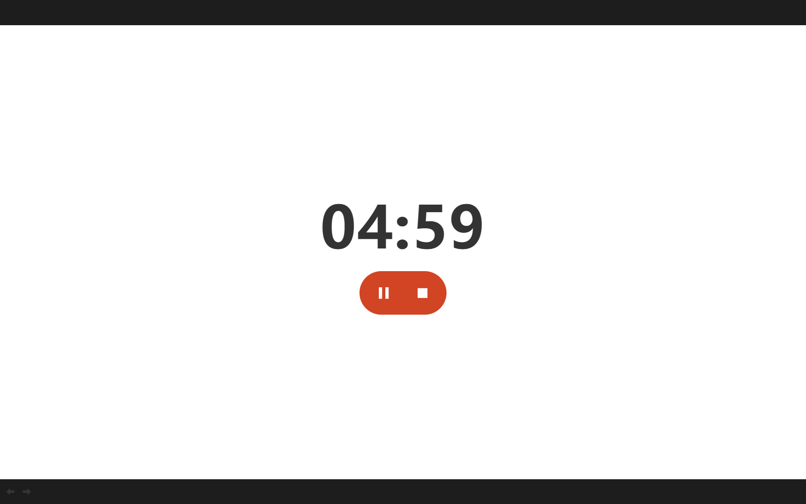
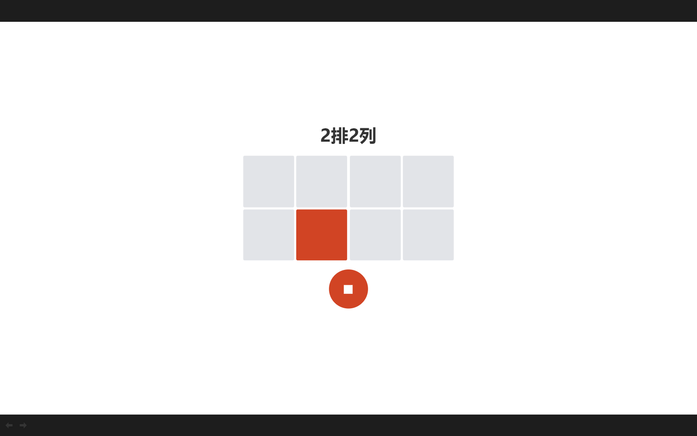
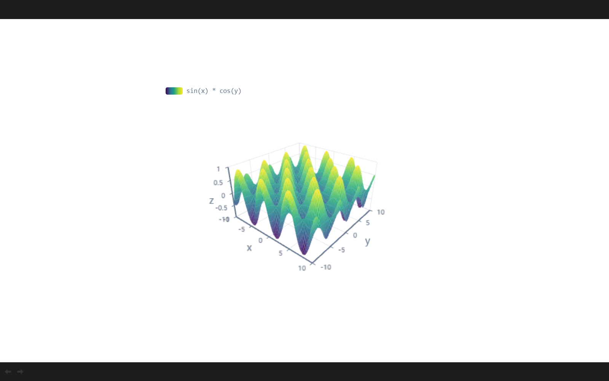

# 可视化组件元素（Widget）

本文档记录在 PPTist 基础上新增的「可视化组件」元素：注册一个新的 `widget` 元素类型，并提供一套可扩展的组件注册机制，让使用者可以在幻灯片里插入**可配置、可在放映时交互**的可视化组件。

整体实现思路参考了 [CustomElement.md](./CustomElement.md) 中「自定义一个元素」的流程，交互形态参考 <https://ppt.klps.top/> 的组件中心与放映交互。

## 功能

- 顶部插入工具栏新增「组件」入口，打开组件中心。
- 内置三种组件：
  - **计时器**：倒计时 / 秒表，支持开始、暂停、继续、停止。
  - **随机点名**：按排×列生成座位矩阵，随机抽取并高亮一个座位。
  - **函数**：输入数学表达式，自动绘制二维函数曲线或三维曲面；表达式中的其他字母会成为可调参数。
- 组件在**编辑画布**中可直接操作，在**放映**时可交互：
  - 计时器按钮、点名按钮、函数参数滑块和输入框均可点击/拖动。
  - 在组件内滚动滚轮、按方向键/空格等不会误翻页。
- 组件支持通用的元素能力：选中、移动、缩放、旋转、复制粘贴、组合、锁定、超链接、动画、层级调整、撤销重做。







## 快速使用

1. 打开编辑器，在顶部工具栏点击「组件」。
2. 在组件中心选择需要的组件，组件会被插入到当前页中央。
3. 选中组件后，在右侧「样式」面板中配置：
   - 计时器：模式（倒计时/秒表）、时长、文字颜色、背景颜色。
   - 随机点名：排数、列数、文字颜色、背景颜色。
   - 函数：表达式（每行一条）、X/Y/Z 取值范围、文字颜色、背景颜色。
4. 点击右上角「幻灯片放映」进入放映，组件中的按钮/滑块即可交互。

### 函数表达式

- 变量：`x`、`y`、`z`。
- 使用一个变量（或常量）时绘制二维曲线，使用两个变量时绘制三维曲面。
- 其他字母会被识别为参数，例如 `(x-a)^2` 中的 `a`；放映时会显示参数滑块和范围输入框。
- 支持 mathjs 的常见函数与常量：`sin`、`cos`、`tan`、`sqrt`、`abs`、`log`、`exp`、`pi`、`e` 等。
- 示例：
  - `sin(x) * cos(y)`：三维曲面。
  - `(x-a)^2`：二维抛物线，`a` 可调。
  - `sin(x) / x`：二维曲线。
  - `x^2 + y^2`：三维抛物面。

> 有多个表达式时，每行一条，会叠加绘制；三维模式下可以点击左上角图例单独显示/隐藏某条表达式。

## 数据结构

元素类型定义在 `src/types/slides.ts`：

```ts
export type WidgetType = 'timer' | 'rollCall' | 'function'

export interface PPTWidgetElement extends PPTBaseElement {
  type: 'widget'
  widgetType: WidgetType
  data: WidgetData
  color?: string
  fill?: string
  outline?: PPTElementOutline
}
```

各组件的数据：

```ts
// 计时器
{ mode: 'countdown' | 'stopwatch', duration: number }

// 随机点名
{ rows: number, cols: number }

// 函数
{
  expressions: string[],
  varRanges: {
    x: { min: number, max: number },
    y: { min: number, max: number },
    z: { min: number, max: number },
  },
}
```

## 代码结构

```
src/
├─ assets/widgets/                       # 组件中心预览图
├─ configs/
│  ├─ element.ts                         # 元素中文名、最小尺寸
│  └─ widgets.ts                         # 组件注册表（名称/描述/组件/默认数据/默认尺寸）
├─ hooks/useCreateElement.ts             # createWidgetElement()
├─ types/slides.ts                       # WidgetType / WidgetData / PPTWidgetElement
├─ views/components/element/WidgetElement/
│  ├─ BaseWidgetElement.vue              # 缩略图等不可交互场景
│  ├─ ScreenWidgetElement.vue            # 放映场景（interactive=true，拦截滚轮/触摸）
│  ├─ index.vue                          # 编辑画布场景（可选中、拖动、右键菜单）
│  └─ widgets/
│     ├─ TimerWidget.vue
│     ├─ RollCallWidget.vue
│     └─ FunctionWidget.vue
├─ views/Editor/CanvasTool/
│  ├─ index.vue                          # 「组件」入口 + 组件中心弹窗
│  └─ WidgetCenter.vue                   # 组件中心
└─ views/Editor/Toolbar/ElementStylePanel/
   ├─ index.vue                          # 注册 WidgetStylePanel
   └─ WidgetStylePanel.vue               # 组件属性编辑面板
```

同时在这些位置补充了 `ElementTypes.WIDGET` 的映射：

- `views/Editor/Canvas/EditableElement.vue`：编辑画布元素组件。
- `views/Editor/Canvas/Operate/index.vue`：操作节点（通用八向缩放）。
- `views/Screen/ScreenElement.vue`：放映元素组件。
- `views/components/ThumbnailSlide/ThumbnailElement.vue`：缩略图元素组件。
- `views/Mobile/MobileEditor/MobileEditableElement.vue`：移动端编辑元素组件。

## 新增一个可视化组件

组件系统是注册式的，新增组件只需要四步：

### 1. 补充类型

在 `src/types/slides.ts` 中扩展 `WidgetType` 和 `WidgetData`：

```ts
export type WidgetType = 'timer' | 'rollCall' | 'function' | 'myWidget'

export interface MyWidgetData {
  // ...
}
export type WidgetData = TimerWidgetData | RollCallWidgetData | FunctionWidgetData | MyWidgetData
```

### 2. 编写组件

在 `src/views/components/element/WidgetElement/widgets/` 下新建组件，统一接收以下 props / 事件：

```ts
const props = withDefaults(defineProps<{
  data: MyWidgetData
  width: number
  height: number
  color?: string
  fill?: string
  interactive?: boolean   // 放映时为 true，缩略图时为 false
}>(), {
  color: '#333333',
  fill: 'transparent',
  interactive: false,
})

const emit = defineEmits<{
  (event: 'interact', payload: Event): void
}>()
```

约定：

- 根节点铺满 `width` / `height`，内部字号和控件尺寸根据宽高自适应。
- `interactive` 为 `false` 时不要响应点击（可以给控件加 `pointer-events: none`）。
- 可交互控件上调用 `emit('interact', event)`，编辑画布会据此选中元素，同时阻止事件冒泡到画布。
- 在放映场景中，滚轮/触摸/键盘事件由外层统一拦截（见 `ScreenWidgetElement.vue` 与 `useExecPlay.ts`），组件内部只需处理自己的交互逻辑。

### 3. 注册

在 `src/configs/widgets.ts` 的 `WIDGET_LIST` 中追加：

```ts
{
  type: 'myWidget',
  name: '我的组件',
  description: '一句话描述',
  component: MyWidget,
  defaultData: () => ({ /* 默认数据 */ }),
  defaultSize: () => ({ width: 480, height: 360 }),
  preview: myPreview, // src/assets/widgets 下的预览图
}
```

组件中心、插入逻辑、缩略图/放映渲染都会自动生效，不需要再改这些映射。

### 4. 添加属性面板

在 `src/views/Editor/Toolbar/ElementStylePanel/WidgetStylePanel.vue` 中按 `widgetType` 增加配置项，修改数据时调用 `updateData({...})`，会同时更新元素并记录历史快照。

## 放映期交互的实现要点

1. **独立放映组件**：`ScreenWidgetElement.vue` 固定传 `interactive=true`，并拦截滚轮、触摸事件，避免触发翻页。
2. **键盘保护**：`useExecPlay.ts` 的全局快捷键监听会跳过 `.screen-element-widget` 内部的事件，因此焦点在按钮、滑块、参数输入框时，方向键/空格/回车不会翻页。
3. **编辑画布交互**：`WidgetElement/index.vue` 在内容区域按下鼠标时以 `canMove=false` 选中元素，避免和组件内部控件冲突；四周保留 20px 拖动条用于移动元素。
4. **缩略图/低交互场景**：`BaseWidgetElement.vue` 默认 `interactive=false`，只渲染静态画面，避免缩略图中误触。
5. **状态局部化**：计时器、点名、函数图的状态保存在组件实例内部；切换页面时不会写入幻灯片数据（只有配置会持久化）。

## 已知限制

- **PPTX 导出**：PPTX 导出逻辑目前不包含 `widget` 元素，导出时会被跳过（与自定义元素文档中「导出需要自行扩展」一致）。如需保留组件画面，可使用「导出图片/PDF」，它们是按 DOM 截图导出的，会包含组件。
- **三维函数**：依赖 `echarts-gl` 与 WebGL，部分禁用 WebGL 的环境会显示「三维图像渲染失败」。
- **PPTX 导入**：无法从 PPTX 反向还原组件，组件只在 PPTist 的 JSON/自定义数据中保留。
- **默认背景透明**：组件默认背景为透明，叠在已有内容上时可能透出底层文字；建议在样式面板中设置背景颜色。

## 依赖

新增了两个运行时依赖（已在 `package.json` 中声明）：

```json
"echarts-gl": "^2.1.0",
"mathjs": "^15.2.0"
```

- `mathjs`：解析、编译函数表达式。
- `echarts-gl`：三维曲面渲染（`surface` series / `grid3D`）。
