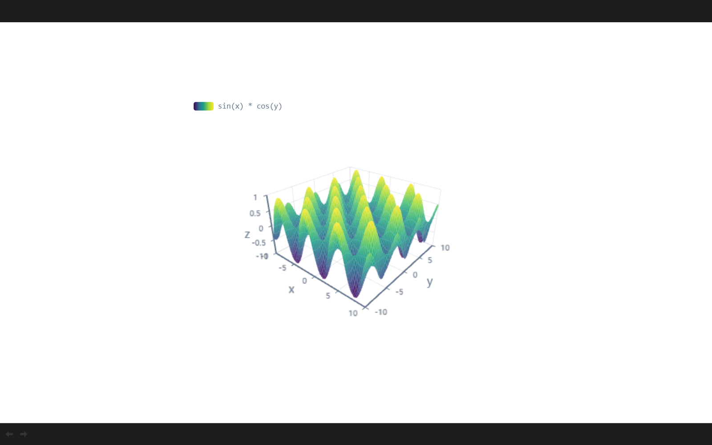
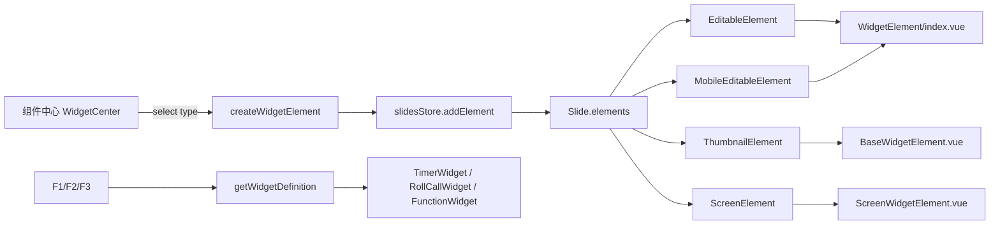
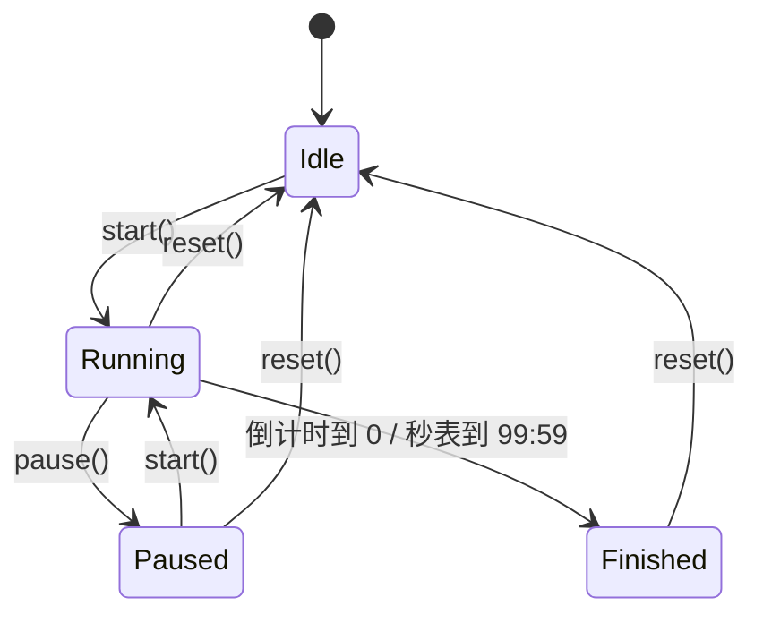

# 可视化组件（Widget）前端实现详解

本文从**仓库源码**出发，完整说明在 PPTist 中新增「可视化组件」元素的前端实现：数据模型、注册表、编辑器/缩略图/放映三套渲染、组件内部算法、放映期事件隔离、构建与部署，以及如何继续扩展新组件。

- 在线入口：<https://alwaysstudent031.github.io/pptist-widget/>
- 代码仓库：<https://github.com/AlwaysStudent031/pptist-widget>
- 代码基准：本仓库 `master` 分支（2026-11）
- 相关文档：[WidgetElement.md](./WidgetElement.md)（使用与扩展概览）、[Deploy.md](./Deploy.md)（部署）、[CustomElement.md](./CustomElement.md)（PPTist 官方自定义元素教程）

---

## 1. 功能范围与用户路径

新增的 `widget` 元素包含三种组件：

| 组件 | 能力 | 数据 |
|---|---|---|
| 计时器 `timer` | 倒计时/秒表，开始、暂停、继续、停止 | `mode`、`duration` |
| 随机点名 `rollCall` | 排×列座位矩阵随机抽取并高亮 | `rows`、`cols` |
| 函数 `function` | 多表达式二维曲线/三维曲面、参数滑块、图例开关 | `expressions`、`varRanges` |



用户路径：

1. 顶部工具栏点击「组件」→ 打开组件中心。
2. 选择组件 → 计算默认尺寸、默认数据，创建元素并选中。
3. 右侧「样式」面板修改组件配置（时长、排/列、表达式、范围、颜色）。
4. 画布中拖拽边缘移动、缩放、旋转，或使用通用元素能力（复制、组合、动画、超链接等）。
5. 放映时组件保持可交互：按钮、滑块、输入框可用，但滚轮/触摸/键盘不会误翻页。

---

## 2. 总体架构

PPTist 本身是**数据驱动**的：幻灯片数据（`Slide[]`）里保存元素数组，编辑器、缩略图、放映、移动端各自把同一份元素数据渲染成不同形态。

新增组件没有绕过这套体系，而是：

1. 在元素类型联合中增加 `PPTWidgetElement`；
2. 在元素注册表 `WIDGET_LIST` 中登记组件；
3. 为三种渲染场景分别提供包装组件；
4. 复用 PPTist 的选择、拖拽、缩放、历史记录、动画、导出等通用能力。



核心分层：

| 层 | 职责 | 代码位置 |
|---|---|---|
| 数据类型层 | 定义元素与组件数据结构 | `src/types/slides.ts` |
| 注册表层 | 组件元信息、默认数据、异步加载 | `src/configs/widgets.ts` |
| 创建层 | 插入元素、居中、选中、历史快照 | `src/hooks/useCreateElement.ts` |
| 编辑入口层 | 工具栏按钮、组件中心、属性面板 | `src/views/Editor/...` |
| 渲染层 | 编辑/缩略图/放映三种包装 | `src/views/components/element/WidgetElement/` |
| 组件层 | 三个具体可视化组件 | `.../WidgetElement/widgets/` |
| 放映交互层 | 事件拦截、快捷键隔离 | `ScreenWidgetElement.vue`、`useExecPlay.ts` |
| 构建部署层 | 依赖、代码分割、Pages/Docker | `package.json`、`vite.config.ts`、`.github/workflows/deploy.yml` |

---

## 3. 数据模型

### 3.1 元素类型

`ElementTypes` 增加 `WIDGET = 'widget'`：

```ts
// src/types/slides.ts
export const enum ElementTypes {
  TEXT = 'text',
  // ...
  AUDIO = 'audio',
  WIDGET = 'widget',
}
```

`PPTElement` 联合类型增加 `PPTWidgetElement`，因此所有接收 `PPTElement` 的通用逻辑（选择、排序、组合、历史记录等）都能直接处理组件元素：

```ts
export type PPTElement =
  | PPTTextElement
  | PPTImageElement
  // ...
  | PPTAudioElement
  | PPTWidgetElement
```

参考：[types/slides.ts:679](../src/types/slides.ts#L679)

### 3.2 组件数据

```ts
export type WidgetType = 'timer' | 'rollCall' | 'function'

export interface WidgetVarRange {
  min: number
  max: number
}

export interface TimerWidgetData {
  mode: 'countdown' | 'stopwatch'
  duration: number        // 秒
}

export interface RollCallWidgetData {
  rows: number
  cols: number
}

export interface FunctionWidgetData {
  expressions: string[]   // 每行一条
  varRanges: Record<'x' | 'y' | 'z', WidgetVarRange>
}

export type WidgetData = TimerWidgetData | RollCallWidgetData | FunctionWidgetData
```

`PPTWidgetElement` 继承 `PPTBaseElement`（`id/left/top/width/height/rotate/link/name...`），并增加：

```ts
export interface PPTWidgetElement extends PPTBaseElement {
  type: 'widget'
  widgetType: WidgetType
  data: WidgetData
  color?: string          // 文字颜色
  fill?: string           // 背景颜色
  outline?: PPTElementOutline
}
```

设计取舍：

- **为什么用 `widgetType + data`，而不是给每种组件单独一个元素类型？**
  组件共享“一个矩形区域 + 背景/边框 + 通用元素能力”，差异只在内部渲染和数据。用一个 `widget` 元素 + 子类型，插入/选择/缩放/动画/复制等逻辑只写一遍。
- **`data` 是联合类型**，运行时按 `widgetType` 收窄。属性面板与组件内部通过 `as TimerWidgetData` 等断言读取；没有引入额外的 schema 校验，保持与 PPTist 其他元素一致的轻量风格。
- 组件**运行状态不持久化**：计时器当前秒数、点名高亮、函数参数值都在组件实例内，不写入 `Slide`。只有配置（时长、行列、表达式、范围、颜色）会持久化。

---

## 4. 组件注册表

`src/configs/widgets.ts` 是整个扩展机制的入口：

```ts
export interface WidgetDefinition {
  type: WidgetType
  name: string
  description: string
  component: Component
  defaultData: () => WidgetData
  defaultSize: () => { width: number, height: number }
  preview: string
}
```

注册表：

```ts
export const WIDGET_LIST: WidgetDefinition[] = [
  {
    type: 'timer',
    name: '计时器',
    description: '倒计时或秒表，上限99分59秒',
    component: TimerWidget,
    defaultData: () => ({ mode: 'countdown', duration: 300 }),
    defaultSize: () => ({ width: 360, height: 180 }),
    preview: timerPreview,
  },
  // rollCall ...
  // function ...
]

export const getWidgetDefinition = (type: WidgetType | string) => {
  return WIDGET_LIST.find(item => item.type === type)
}
```

参考：[configs/widgets.ts:16](../src/configs/widgets.ts#L16)

### 4.1 函数组件的异步加载

函数组件依赖 `mathjs` 和 `echarts-gl`，如果同步打进主包，首屏会显著变大。这里使用 Vue 的 `defineAsyncComponent`：

```ts
const FunctionWidget = defineAsyncComponent(() => {
  return import('@/views/components/element/WidgetElement/widgets/FunctionWidget.vue')
})
```

效果：

- 主包不包含 mathjs/echarts-gl；
- 只有真正插入/渲染函数组件时才加载对应 chunk；
- Vite 自动为该组件生成独立的 JS/CSS chunk（构建产物中约 1.86 MB，主包约 3.17 MB）。

注意：缩略图/放映中如果存在函数组件，也会触发该 chunk 加载，这是预期行为。

---

## 5. 创建与插入流程

### 5.1 工具栏入口

`CanvasTool/index.vue` 在「符号」后增加「组件」按钮：

```html
<div class="insert-handler-item" v-tooltip="'插入可视化组件'" @click="widgetCenterVisible = true">
  <i-icon-park-outline:components class="icon" /> <span class="text">组件</span>
</div>
```

弹窗：

```html
<Modal v-model:visible="widgetCenterVisible" :width="880" closeButton>
  <WidgetCenter
    @select="type => { createWidgetElement(type); widgetCenterVisible = false }"
  />
</Modal>
```

参考：[CanvasTool/index.vue:123](../src/views/Editor/CanvasTool/index.vue#L123)

`WidgetCenter.vue` 只负责展示注册表并抛出类型：

```html
<div v-for="item in WIDGET_LIST" :key="item.type" class="widget-card" @click="emit('select', item.type)">
  
  <div class="name">{{ item.name }}</div>
  <div class="desc">{{ item.description }}</div>
</div>
```

参考：[WidgetCenter.vue:6](../src/views/Editor/CanvasTool/WidgetCenter.vue#L6)

### 5.2 创建元素

```ts
const createWidgetElement = (widgetType: WidgetType) => {
  const definition = getWidgetDefinition(widgetType)
  if (!definition) return

  const { width, height } = definition.defaultSize()

  createElement({
    type: 'widget',
    id: nanoid(10),
    widgetType,
    data: definition.defaultData(),
    left: (viewportSize.value - width) / 2,
    top: (viewportSize.value * viewportRatio.value - height) / 2,
    width,
    height,
    rotate: 0,
    color: theme.value.fontColor,
  })
}
```

参考：[useCreateElement.ts:323](../src/hooks/useCreateElement.ts#L323)

`createElement()` 是 PPTist 已有的通用创建函数，负责：

1. `slidesStore.addElement(element)` 写入当前页；
2. `mainStore.setActiveElementIdList([id])` 选中新元素；
3. 清除“正在绘制”状态，把焦点还给编辑区；
4. `addHistorySnapshot()` 记录历史，支持 Ctrl+Z。

因此组件天然拥有“插入后可撤销、可复制、可删除”的能力。

---

## 6. 三套渲染组件

同一个 `PPTWidgetElement` 在不同场景下需要不同的交互策略：

| 场景 | 组件 | `interactive` | 事件处理 |
|---|---|---|---|
| 编辑画布 | `WidgetElement/index.vue` | `true` | 内容区按下选中（不拖动）；四边拖动条移动；组件控件可操作 |
| 缩略图 | `BaseWidgetElement.vue` | `false` | `pointer-events: none`，纯静态画面 |
| 放映 | `ScreenWidgetElement.vue` | `true` | 拦截滚轮/触摸，组件控件可操作 |
| 移动端编辑 | `WidgetElement/index.vue` | `true` | 触摸选中，拖动条移动 |

### 6.1 编辑画布：`WidgetElement/index.vue`

外层负责定位与旋转：

```html
<div class="editable-element-widget" :class="{ lock: elementInfo.lock }"
  :style="{ top, left, width, height }">
  <div class="rotate-wrapper" :style="{ transform: `rotate(${elementInfo.rotate}deg)` }">
    <div class="element-content"
      v-contextmenu="contextmenus"
      @mousedown="$event => handleSelectElement($event, false)"
      @touchstart="$event => handleSelectElement($event, false)"
      @wheel.stop
    >
      <ElementOutline ... />
      <component :is="widgetComponent" ... :interactive="true" @interact="handleInteract" />

      <div class="drag-handler top" @mousedown="..."></div>
      <div class="drag-handler bottom" @mousedown="..."></div>
      <div class="drag-handler left" @mousedown="..."></div>
      <div class="drag-handler right" @mousedown="..."></div>
    </div>
  </div>
</div>
```

关键点：

- **内容区 `canMove=false`**：在组件内部按下鼠标只“选中”，不启动元素拖动，避免和计时按钮/滑块冲突；
- **四边 20px 拖动条 `canMove=true`**：给用户保留移动元素的手柄；
- **`@wheel.stop`**：编辑画布滚轮用于缩放画布，组件内滚轮不应触发；
- **`@interact`**：组件控件点击时通知包装层选中元素（同时组件内部已 `stop` 事件）；
- `v-contextmenu` 复用 PPTist 右键菜单；
- `ElementOutline` 复用统一边框渲染。

参考：[WidgetElement/index.vue:16](../src/views/components/element/WidgetElement/index.vue#L16)

`handleSelectElement` 与 `handleInteract`：

```ts
const handleSelectElement = (e: MouseEvent | TouchEvent, canMove = true) => {
  if (props.elementInfo.lock) return
  e.stopPropagation()
  props.selectElement(e, props.elementInfo, canMove)
}

const handleInteract = (e: Event) => {
  props.selectElement(e as MouseEvent, props.elementInfo, false)
}
```

### 6.2 缩略图：`BaseWidgetElement.vue`

缩略图只负责“看起来像”：

```html
<div class="base-element-widget" :class="{ 'is-thumbnail': target === 'thumbnail' }">
  <div class="rotate-wrapper" :style="{ transform: `rotate(${rotate}deg)` }">
    <div class="element-content" :style="{ backgroundColor: fill }">
      <ElementOutline ... />
      <component :is="widgetComponent" ... :interactive="interactive" />
    </div>
  </div>
</div>
```

- `interactive` 默认 `false`；
- 缩略图样式 `pointer-events: none`，避免在缩略图列表里误触；
- 计时器/点名仍会渲染静态状态，函数仍会初始化图表（缩略图需要画面）。

参考：[BaseWidgetElement.vue:22](../src/views/components/element/WidgetElement/BaseWidgetElement.vue#L22)

### 6.3 放映：`ScreenWidgetElement.vue`

放映版与缩略图版结构相同，但：

```html
<div class="base-element-widget screen-element-widget">
  ...
  <div class="element-content"
    @wheel.stop
    @touchstart.stop
    @touchend.stop
  >
    <component :is="widgetComponent" ... :interactive="true" />
  </div>
</div>
```

- 根节点同时带 `base-element-widget` 和 `screen-element-widget`：
  - `base-element-*` 是 PPTist 动画系统查找元素节点的选择器；
  - `screen-element-widget` 是键盘事件隔离用的标记。
- `@wheel.stop`：阻止 `ScreenSlideList` 的滚轮翻页；
- `@touchstart.stop` / `@touchend.stop`：阻止触摸滑动翻页。

参考：[ScreenWidgetElement.vue:15](../src/views/components/element/WidgetElement/ScreenWidgetElement.vue#L15)

### 6.4 类型映射

在三处渲染入口注册 `ElementTypes.WIDGET`：

```ts
// EditableElement.vue
[ElementTypes.WIDGET]: WidgetElement

// ScreenElement.vue
[ElementTypes.WIDGET]: ScreenWidgetElement

// ThumbnailElement.vue
[ElementTypes.WIDGET]: BaseWidgetElement

// MobileEditableElement.vue
[ElementTypes.WIDGET]: WidgetElement
```

以及操作节点：

```ts
// Editor/Canvas/Operate/index.vue
[ElementTypes.WIDGET]: CommonElementOperate
```

`CommonElementOperate` 提供八向缩放手柄、边线、旋转手柄；组件元素支持旋转（`BaseWidgetElement` 和 `ScreenWidgetElement` 都通过 `rotate-wrapper` 应用 `rotate`）。

---

## 7. 属性面板

`WidgetStylePanel.vue` 根据 `widgetType` 渲染不同配置区，并在最后统一提供文字颜色、背景颜色。

```html
<template v-if="widgetType === 'timer'">
  <Select :value="timerData.mode" :options="timerModeOptions" @update:value="..."/>
  <NumberInput :value="minute" @update:value="v => setDuration(v, second)"/>
  <NumberInput :value="second" @update:value="v => setDuration(minute, v)"/>
</template>

<template v-else-if="widgetType === 'rollCall'">
  <NumberInput :value="rollCallData.rows" :min="1" :max="16" @update:value="..."/>
  <NumberInput :value="rollCallData.cols" :min="1" :max="16" @update:value="..."/>
</template>

<template v-else-if="widgetType === 'function'">
  <Textarea :rows="5" :value="expressionsText" @update:value="setExpressions" @blur="addHistorySnapshot()" />
  <NumberInput v-for="name in varNames" ... />
</template>
```

核心更新函数：

```ts
const updateWidget = (props: Partial<PPTWidgetElement>) => {
  if (!handleElement.value) return
  slidesStore.updateElement({ id: handleElement.value.id, props })
  addHistorySnapshot()
}

const updateData = (patch: Record<string, unknown>, record = true) => {
  if (!handleWidgetElement.value) return

  const data = {
    ...(handleWidgetElement.value.data as unknown as Record<string, unknown>),
    ...patch,
  }
  slidesStore.updateElement({
    id: handleWidgetElement.value.id,
    props: { data } as unknown as Partial<PPTElement>,
  })
  if (record) addHistorySnapshot()
}
```

参考：[WidgetStylePanel.vue:165](../src/views/Editor/Toolbar/ElementStylePanel/WidgetStylePanel.vue#L165)

几个细节：

- **倒计时时长**：分钟 0–99、秒 0–59，统一折算成 `duration` 秒；组件端再做一次 `0..5999` 的兜底。
- **点名行列**：1–16，保存前取整并夹紧。
- **函数表达式**：输入时立即写入 store（`record=false`），让画布实时预览；失焦时 `addHistorySnapshot()` 合并成一次可撤销操作，避免每敲一个字符产生一条历史。
- **取值范围**：归一化到 `[-9999, 9999]`，`min > max` 自动交换；非有限值归零。
- **颜色**：`color`/`fill` 直接写元素顶层字段，组件通过 props 接收。

---

## 8. 计时器组件

文件：[TimerWidget.vue](../src/views/components/element/WidgetElement/widgets/TimerWidget.vue)

### 8.1 Props 与状态

```ts
const props = withDefaults(defineProps<{
  data: TimerWidgetData
  width: number
  height: number
  color?: string
  fill?: string
  interactive?: boolean
}>(), {
  color: '#333333',
  fill: 'transparent',
  interactive: false,
})

const elapsed = ref(0)
const running = ref(false)
const finished = ref(false)
let timer: ReturnType<typeof setInterval> | null = null
```

状态机：



### 8.2 显示计算

```ts
const MAX_SECONDS = 5999
const mode = computed(() => props.data?.mode || 'countdown')
const duration = computed(() => {
  const value = Number(props.data?.duration)
  return Number.isFinite(value) ? Math.max(0, Math.min(MAX_SECONDS, value)) : 0
})

const remaining = computed(() => {
  if (mode.value === 'stopwatch') return elapsed.value
  return Math.max(0, duration.value - elapsed.value)
})

const display = computed(() => {
  const minutes = Math.floor(remaining.value / 60)
  const seconds = remaining.value % 60
  return `${String(minutes).padStart(2, '0')}:${String(seconds).padStart(2, '0')}`
})
```

- 秒表：显示 `elapsed`，从 0 向上；
- 倒计时：显示 `duration - elapsed`，最小 0；
- 上限 99:59（5999 秒），避免三位分钟破坏布局。

### 8.3 尺寸自适应

```ts
const displayFontSize = computed(() => {
  const byHeight = props.height * 0.4
  const byWidth = props.width / (display.value.length * 0.62)
  return Math.max(12, Math.min(byHeight, byWidth))
})

const buttonSize = computed(() => {
  return Math.max(28, Math.min(props.height * 0.3, props.width * 0.3, 64))
})
```

- 字号同时受高度和宽度约束，缩到很小时不低于 12px；
- 按钮直径 28–64px，随组件缩放；
- 所有尺寸都在 `props.width/height` 变化时自动重算，不需要 ResizeObserver。

### 8.4 计时逻辑

```ts
const start = () => {
  if (!props.interactive || running.value) return

  running.value = true
  clearTimer()

  timer = setInterval(() => {
    elapsed.value += 1

    const reached = mode.value === 'countdown'
      ? remaining.value <= 0
      : elapsed.value >= MAX_SECONDS
    if (reached) {
      pause()
      finished.value = true
    }
  }, 1000)
}
```

- 只有 `interactive=true` 才能启动，缩略图中按钮无效；
- 使用 1 秒 `setInterval`，状态变化驱动 UI；
- 倒计时到 0、秒表到 5999 秒时自动暂停并标记 `finished`；
- `watch(() => [mode, duration], reset)`：属性面板改模式/时长时回到初始状态；
- `onUnmounted(clearTimer)`：销毁时清理定时器，避免泄漏。

### 8.5 控件模板

按钮区域根据状态显示不同组合：

| 状态 | 显示 |
|---|---|
| `finished` | 一个「停止」按钮（重置） |
| `isActive && running` | 胶囊按钮：暂停 + 停止 |
| `isActive && !running` | 胶囊按钮：继续 + 停止 |
| 初始 | 一个「开始」按钮 |

```html
<div class="control-btn" :class="{ pill: isActive }"
  @mousedown.stop @touchstart.stop @click.stop="emit('interact', $event)">
  <template v-if="finished">...</template>
  <template v-else-if="isActive">...</template>
  <template v-else>...</template>
</div>
```

- `mousedown/touchstart.stop`：防止拖动/触摸穿透到画布；
- `click.stop` + `emit('interact')`：让编辑画布选中元素，同时阻止事件继续冒泡；
- `.controls.static { pointer-events: none }`：`interactive=false` 时按钮不可点。

---

## 9. 随机点名组件

文件：[RollCallWidget.vue](../src/views/components/element/WidgetElement/widgets/RollCallWidget.vue)

### 9.1 行列与座位

```ts
const MAX_SIZE = 16
const rows = computed(() => Math.min(MAX_SIZE, Math.max(1, Number(props.data?.rows) | 0)))
const cols = computed(() => Math.min(MAX_SIZE, Math.max(1, Number(props.data?.cols) | 0)))
const seats = computed(() => new Array(rows.value * cols.value).fill(0))
```

- 行列都夹紧到 1–16；
- 座位用一维数组表示，索引 `i` 对应第 `floor(i/cols)+1` 排、第 `i%cols+1` 列。

### 9.2 自适应布局

```ts
const resultFontSize = computed(() => Math.max(11, props.height * 0.09))
const buttonSize = computed(() => Math.max(22, Math.min(props.height * 0.22, props.width * 0.3, 56)))
const gapSize = computed(() => Math.max(2, Math.min(props.width, props.height) * 0.012))

const seatSize = computed(() => {
  const controlsHeight = buttonSize.value + 14
  const resultHeight = resultFontSize.value * 1.6 + 8
  const width = (props.width - 20 - gapSize.value * (cols.value - 1)) / cols.value
  const height = (props.height - resultHeight - controlsHeight - 12 - gapSize.value * (rows.value - 1)) / rows.value
  return Math.max(2, Math.min(width, height))
})
```

布局顺序：结果文字 → 座位矩阵 → 控件。`seatSize` 同时扣掉结果区高度、按钮高度、内边距与间隙，取宽高约束的较小值。

矩阵用 CSS Grid：

```ts
const matrixStyle = computed(() => ({
  gridTemplateColumns: `repeat(${cols.value}, ${seatSize.value}px)`,
  gap: gapSize.value + 'px',
}))
```

### 9.3 抽取动画

```ts
const draw = () => {
  const total = rows.value * cols.value
  if (total <= 0) return
  if (total === 1) { resultIndex.value = 0; return }

  const finalIndex = Math.floor(Math.random() * total)
  const SPIN_COUNT = 15
  drawing.value = true
  let step = 0

  const tick = () => {
    let index = Math.floor(Math.random() * total)
    while (index === resultIndex.value) index = Math.floor(Math.random() * total)

    resultIndex.value = index
    step += 1

    if (step < SPIN_COUNT) {
      timer = setTimeout(tick, 35 + step * 18)
    }
    else {
      resultIndex.value = finalIndex
      drawing.value = false
      timer = null
    }
  }

  tick()
}
```

效果：

- 先随机“滚动”15 次，间隔从 35ms 逐步增加到约 287ms，形成减速停止；
- 每次高亮避免与上一次相同；
- 结果在开始时已经确定，最后一步落到 `finalIndex`；
- `stop()` 清理 timeout 并重置结果；
- 行列变化时 `watch` 自动停止并重置。

结果文字：

```ts
const resultText = computed(() => {
  if (resultIndex.value === -1) return '准备开始'
  const row = Math.floor(resultIndex.value / cols.value) + 1
  const col = (resultIndex.value % cols.value) + 1
  return `${row}排${col}列`
})
```

---

## 10. 函数组件（核心）

文件：[FunctionWidget.vue](../src/views/components/element/WidgetElement/widgets/FunctionWidget.vue)

这是三个组件里最复杂的：它需要解析用户表达式、识别变量/参数、决定 2D/3D、采样、渲染 ECharts、处理参数交互和尺寸变化。

### 10.1 依赖与数据

```ts
import { parse } from 'mathjs'
import * as echarts from 'echarts'
import 'echarts-gl'
import type { FunctionWidgetData, WidgetVarRange } from '@/types/slides'
```

```ts
const VAR_NAMES = ['x', 'y', 'z'] as const
const MATH_CONSTANTS = new Set(['pi', 'e', 'tau', 'phi', 'i', 'Infinity', 'NaN', 'true', 'false', 'null'])
const VIRIDIS = ['#440154', '#46327e', '#365c8d', '#277f8e', '#1fa187', '#4ac16d', '#a0da39', '#fde725']
const SERIES_COLORS = ['#d14424', '#5470c6', '#91cc75', '#fac858', '#ee6666', '#73c0de', '#3ba272', '#fc8452', '#9a60b4']
```

- `mathjs` 负责语法解析和编译求值；
- `echarts` 负责 2D 折线图；
- `echarts-gl` 注册 `surface` series 和 `grid3D`，负责 3D 曲面。

### 10.2 解析表达式

中间结构：

```ts
interface ParsedExpression {
  expr: string
  ok: boolean
  empty: boolean
  vars: string[]       // x/y/z 中被使用的
  symbols: string[]    // 除常量外的符号（候选参数）
  compiled: { evaluate: (scope: Record<string, number>) => unknown } | null
  error?: string
}
```

解析逻辑：

```ts
const node = parse(expr)
const symbols = new Set<string>()

node.traverse((child: any, _path: string, parent: any) => {
  if (!child.isSymbolNode || !child.name) return
  // 函数名（sin、cos 等）不是可调参数
  if (parent?.isFunctionNode && parent.fn === child) return
  symbols.add(child.name)
})

const vars = VAR_NAMES.filter(name => symbols.has(name))
const compiled = node.compile()
```

这里有两个容易踩坑的点：

1. **函数名也会被 mathjs 当成 `SymbolNode`**。例如 `sin(x)` 的 AST 中，`sin` 是 `FunctionNode.fn`。如果不排除，参数面板会错误地出现 `sin`、`cos` 滑块。通过 `parent.isFunctionNode && parent.fn === child` 过滤。
2. **常量不是参数**。`pi`、`e` 等会进入 `symbols`，但在 `rebuild()` 汇总参数时会用 `MATH_CONSTANTS` 排除。

参考：[FunctionWidget.vue:179](../src/views/components/element/WidgetElement/widgets/FunctionWidget.vue#L179)

### 10.3 变量与参数

```ts
const VAR_NAMES = ['x', 'y', 'z'] as const
```

- 表达式中用到的 `x/y/z` 数量：
  - `0` 或 `1` 个 → **2D**；
  - `2` 个 → **3D**；
  - `3` 个 → 仍按 2D 处理（当前版本的三维曲面只支持两个自变量）。

参数同步：

```ts
const syncParams = (symbols: Set<string>) => {
  for (const name of Object.keys(paramValues)) {
    if (!symbols.has(name)) {
      delete paramValues[name]
      delete paramRanges[name]
    }
  }

  for (const name of symbols) {
    if (!(name in paramRanges)) paramRanges[name] = { min: -10, max: 10 }
    if (!(name in paramValues)) paramValues[name] = 1
  }
}
```

- 新参数默认值 `1`，范围 `[-10, 10]`；
- 删除表达式后，对应参数和范围自动清理；
- `clampParamValue` 保证 value 落在范围内，且 `min <= max`。

参考：[FunctionWidget.vue:230](../src/views/components/element/WidgetElement/widgets/FunctionWidget.vue#L230)

### 10.4 2D 曲线

采样：

```ts
const axisVar = usedVars.value[0] || 'x'
const range = getVarRange(axisVar)
const sampleCount = Math.min(800, Math.max(160, Math.round(props.width * 1.6)))

for (let i = 0; i < sampleCount; i++) {
  const value = range.min + (range.max - range.min) * i / (sampleCount - 1)
  scope[axisVar] = value
  const output = Number(item.compiled?.evaluate(scope))
  // 非有限值 → null，曲线断开
}
```

- 采样点数随宽度变化，160–800；
- 每个表达式一条 `line` series，颜色从 `SERIES_COLORS` 循环；
- 计算失败/`NaN`/`Infinity` 用 `null`，`connectNulls: false` 让断点保留；
- y 轴范围由所有采样值计算并加 15% padding，避免曲线贴边。

ECharts option：

```ts
{
  animation: false,
  tooltip: { trigger: 'axis', confine: true },
  legend: { show: true, type: 'scroll', top: 8, left: 8, ... },
  grid: { left: 6, right: 12, top: 36, bottom: 0, containLabel: true },
  xAxis: { type: 'value', min, max, name: axisVar, ... },
  yAxis: { type: 'value', min: yMin, max: yMax, name: axisVar === 'x' ? 'y' : 'f', ... },
  series: seriesData,
}
```

参考：[FunctionWidget.vue:285](../src/views/components/element/WidgetElement/widgets/FunctionWidget.vue#L285)

### 10.5 3D 曲面

当恰好使用两个变量时：

```ts
const xVar = usedVars.value[0]
const yVar = usedVars.value[1]
const zVar = VAR_NAMES.find(name => name !== xVar && name !== yVar) || 'z'
const resolution = Math.min(80, Math.max(20, Math.round(Math.min(props.width, props.height) / 5)))
```

网格采样：

```ts
for (let i = 0; i < resolution; i++) {
  const x = xRange.min + (xRange.max - xRange.min) * i / (resolution - 1)
  for (let j = 0; j < resolution; j++) {
    const y = yRange.min + (yRange.max - yRange.min) * j / (resolution - 1)
    scope[xVar] = x
    scope[yVar] = y
    const z = Number(item.compiled?.evaluate(scope))
    // 记录 zMin/zMax；非法值写 NaN
  }
}
```

series：

```ts
{
  name: item.expr,
  type: 'surface',
  shading: 'color',
  dataShape: [resolution, resolution],
  wireframe: {
    show: true,
    lineStyle: { color: 'rgba(255,255,255,0.22)', width: 1 },
  },
  data,
}
```

- `dataShape` 显式告诉 echarts-gl 一维数据的网格形状，避免控制台警告/错误猜测；
- `visualMap` 使用 `VIRIDIS` 色带，按 z 值着色；
- `grid3D` 固定视角参数（distance/alpha/beta）、坐标轴颜色、分割线；
- 多个表达式会叠加多个 surface，左上角 HTML 图例可单独隐藏；
- 用 `try/catch` 捕获渲染异常，显示「三维图像渲染失败，请检查表达式」。

参考：[FunctionWidget.vue:401](../src/views/components/element/WidgetElement/widgets/FunctionWidget.vue#L401)

### 10.6 重建、防抖与生命周期

```ts
const rebuild = () => {
  const list = parseExpressions()
  parsed.value = list

  const valid = list.filter(item => item.ok && !item.empty)
  usedVars.value = VAR_NAMES.filter(name => valid.some(item => item.vars.includes(name)))
  mode.value = usedVars.value.length === 2 ? '3d' : '2d'

  // 汇总参数符号，同步 paramValues/paramRanges
  syncParams(symbols)
  for (const name of Object.keys(paramRanges)) {
    if (name in paramValues) clampParamValue(name)
  }

  nextTick(() => {
    render()
    setTimeout(() => {
      chart2d?.resize()
      chart3d?.resize()
    }, 0)
  })
}
```

防抖策略：

| 变化来源 | 延迟 |
|---|---|
| 表达式 | 250ms |
| 取值范围 | 150ms |
| 参数值（滑块） | 80ms |
| 参数范围 | 150ms |

```ts
watch(() => props.data?.expressions, () => scheduleRebuild(250), { deep: true })
watch(() => props.data?.varRanges, () => scheduleRebuild(150), { deep: true })
watch(paramValues, () => scheduleRebuild(80), { deep: true })
watch(paramRanges, () => { /* clamp */ scheduleRebuild(150) }, { deep: true })
```

生命周期：

```ts
onMounted(() => {
  rebuild()
  resizeObserver = new ResizeObserver(() => {
    chart2d?.resize()
    chart3d?.resize()
  })
  resizeObserver.observe(rootRef.value)
})

onBeforeUnmount(() => {
  if (updateTimer) clearTimeout(updateTimer)
  resizeObserver?.disconnect()
  chart2d?.dispose()
  chart3d?.dispose()
  chart2d = null
  chart3d = null
})
```

- 两个图表实例（2D/3D）都在第一次需要时初始化，避免无谓开销；
- `ResizeObserver` 监听根节点，元素缩放时重排图表；
- 卸载时清理计时器、观察器和 ECharts 实例，防止 WebGL/Canvas 泄漏。

参考：[FunctionWidget.vue:526](../src/views/components/element/WidgetElement/widgets/FunctionWidget.vue#L526)

### 10.7 参数 UI 与图例

参数行：

```html
<div class="fs-param">
  <span class="fs-pname">{{ param.name }}</span>
  <input class="fs-prange" type="range" :min="param.min" :max="param.max"
    step="0.01" v-model.number="paramValues[param.name]" />
  <span class="fs-pval">{{ formatValue(paramValues[param.name]) }}</span>
  <span class="fs-pin">∈ [</span>
  <input class="fs-pnum" type="number" step="any" v-model.number="paramRanges[param.name].min" />
  <span class="fs-psep">,</span>
  <input class="fs-pnum" type="number" step="any" v-model.number="paramRanges[param.name].max" />
  <span class="fs-pin">]</span>
</div>
```

- 滑块范围来自 `paramRanges`，数值实时写回 `paramValues`；
- 范围输入框可修改 min/max，`watch` 会重新夹紧当前值；
- 外层 `@mousedown.stop`、`@touchstart.stop`、`@keydown.stop`、`@click.stop`，防止拖动/快捷键穿透。

3D 图例：

```html
<button v-for="item in availableSeries" :key="item.name"
  :class="{ off: hiddenSeries[item.name] === false }"
  @click="toggleSeries(item.name)">
  <span class="fs-lmarker"></span>
  <span class="fs-ltext">{{ item.name }}</span>
</button>
```

```ts
const toggleSeries = (name: string) => {
  hiddenSeries[name] = hiddenSeries[name] === false
  if (mode.value === '3d') render3d()
}
```

隐藏通过过滤 series 实现（`hiddenSeries[item.name] !== false`），不是改 ECharts legend 配置，因此能和自定义 HTML 图例保持一致。

### 10.8 错误提示

```ts
const expressionError = computed(() => {
  if (parsed.value.some(item => !item.ok)) return '表达式有误，请检查'
  const hasInput = (props.data?.expressions || []).some(item => String(item ?? '').trim())
  if (hasInput && !validExpressions.value.length) return '没有可绘制的表达式'
  return ''
})

const errorMessage = computed(() => chartError.value || expressionError.value)
```

- 语法错误 → 「表达式有误」；
- 全部为空/无有效表达式 → 「没有可绘制的表达式」；
- 3D 渲染异常 → 「三维图像渲染失败」；
- 错误以绝对定位的浮层显示在图表中央，不阻塞参数操作。

---

## 11. 放映期交互与事件隔离

这是“能看”与“能操作”的关键。

### 11.1 `interactive` 开关

- 编辑画布：`interactive=true`（允许编辑时调试组件）；
- 放映：`interactive=true`；
- 缩略图：`interactive=false`（静态、不可点）。

组件内部所有会改变状态的入口都会检查它，例如计时器：

```ts
const start = () => {
  if (!props.interactive || running.value) return
  // ...
}
```

### 11.2 滚轮与触摸

放映页的翻页监听挂在 `ScreenSlideList` 上：

- 滚轮：`@wheel="mousewheelListener"`；
- 触摸：`@touchstart` / `@touchend`。

如果组件不拦截，用户在滑块上滚动、在图表上拖动都会触发翻页。因此 `ScreenWidgetElement` 在内容层直接 `.stop`：

```html
<div class="element-content"
  @wheel.stop
  @touchstart.stop
  @touchend.stop
>
```

事件在组件内容层停止冒泡，`ScreenSlideList` 收不到，翻页不会发生。

### 11.3 键盘隔离

全局快捷键在 `useExecPlay.ts`：

```ts
const keydownListener = throttle(function(e: KeyboardEvent) {
  // 焦点在可视化组件内时（按钮、滑块、参数输入框等），不响应翻页快捷键
  const target = e.target as HTMLElement | null
  if (target?.closest('.screen-element-widget')) return

  const key = e.key.toUpperCase()
  if (key === KEYS.UP || key === KEYS.LEFT || key === KEYS.PAGEUP) execPrev()
  else if (key === KEYS.DOWN || key === KEYS.RIGHT || key === KEYS.SPACE || key === KEYS.ENTER || key === KEYS.PAGEDOWN) execNext()
}, 500, { leading: true, trailing: false })
```

为什么用 `closest`：

- 事件目标可能是 `<button>`、`<input>`、`<svg>`、`<path>` 等任意子节点；
- `closest('.screen-element-widget')` 向上查找最近的组件根，能覆盖整个组件子树；
- 方向键在滑块上调整数值、空格在按钮上触发点击时，不会再翻页。

参考：[useExecPlay.ts:260](../src/views/Screen/hooks/useExecPlay.ts#L260)

### 11.4 点击与超链接

`ScreenElement` 外层有 `@click="openLink"`。组件内部按钮的 click 会冒泡到外层，但：

- 没有设置 `link` 时，`openLink` 直接返回；
- 设置链接后，点击组件控件可能触发链接，这是 PPTist 通用行为；如果不需要，可在组件内对特定控件 `@click.stop`。

### 11.5 状态与切页

- 组件状态保存在组件实例中，**不写入幻灯片数据**；
- 放映时 `ScreenSlideList` 同时挂载当前页及相邻页，因此小范围切页再回来，计时器/点名状态可能保留；
- 组件卸载时清理定时器/图表；长时间离开后回来会重置。

### 11.6 动画兼容

PPTist 的动画系统通过选择器查找元素节点：

```ts
document.querySelector(`#screen-element-${animation.elId} [class^=base-element-]`)
```

`ScreenWidgetElement` 根节点同时带 `base-element-widget`，因此入场、退场、强调动画都能直接作用在组件根节点上，无需额外适配。

---

## 12. 复用的通用编辑能力

因为 `widget` 是标准 `PPTElement`，以下能力不需要单独实现：

| 能力 | 实现方式 |
|---|---|
| 选中/多选 | `EditableElement` + 通用选择逻辑 |
| 移动 | 四边 `drag-handler` + `selectElement(..., true)` |
| 缩放 | `CommonElementOperate` 八向手柄 |
| 旋转 | `CommonElementOperate` 旋转手柄 + `rotate-wrapper` |
| 右键菜单 | `v-contextmenu` 复用 `contextmenus` |
| 复制/剪切/粘贴 | 元素 JSON 序列化，`data` 自动携带 |
| 组合/取消组合 | 通用 `groupId` 逻辑 |
| 锁定 | `elementInfo.lock`，内容区按下直接返回 |
| 层级调整 | 通用 order 逻辑 |
| 超链接 | 通用 `link` 字段 + `ScreenElement` |
| 动画 | 通用 `base-element-*` 选择器 |
| 撤销/重做 | 创建与属性修改时 `addHistorySnapshot()` |

---

## 13. 样式与自适应

### 13.1 主题色

组件按钮、滑块使用 SCSS 变量 `$themeColor`：

```scss
.control-btn {
  background-color: $themeColor;
}
```

`$themeColor` 由 `src/assets/styles/variable.scss` 定义，和 PPTist 主题色保持一致。

### 13.2 尺寸驱动

三个组件都没有使用固定 px 布局，而是由 `width/height` 计算：

- 计时器：字号/按钮直径；
- 点名：结果字号、按钮、间距、座位边长；
- 函数：2D 采样点数、3D 网格分辨率、图例/参数区高度由 flex 布局自适应。

因此用户拖动缩放元素时，组件会即时重排，不需要额外监听。

### 13.3 透明背景

`fill` 默认 `transparent`，组件会透出幻灯片底层内容；属性面板提供背景色选择。若希望默认不透明，可在 `createWidgetElement` 中给 `fill: '#ffffff'`。

---

## 14. 构建与部署

### 14.1 依赖

`package.json` 新增：

```json
"echarts-gl": "^2.1.0",
"mathjs": "^15.2.0"
```

- `mathjs`：表达式解析、编译、求值；
- `echarts-gl`：3D 曲面（`surface`、`grid3D`）；
- 项目原有 `echarts@^6` 继续用于 2D 图表。

### 14.2 代码分割

`FunctionWidget` 使用 `defineAsyncComponent`，构建后：

- 主包：约 3.17 MB（gzip ~1.05 MB）；
- 函数组件 chunk：约 1.86 MB（gzip ~0.55 MB）；
- 只有插入/渲染函数组件时才加载。

### 14.3 相对路径

```ts
// vite.config.ts
base: ''
```

所有资源使用相对路径，因此可以部署在：

- 域名根目录：`https://ppt.example.com/`；
- 子路径：`https://user.github.io/pptist-widget/`。

### 14.4 GitHub Pages

`.github/workflows/deploy.yml`：

```yaml
permissions:
  contents: read
  pages: write
  id-token: write

jobs:
  build:
    steps:
      - uses: actions/checkout@v4
      - uses: actions/setup-node@v4
        with: { node-version: 20, cache: npm }
      - run: npm ci
      - run: npm run build
      - uses: actions/configure-pages@v5
        with: { enablement: true }
      - uses: actions/upload-pages-artifact@v3
        with: { path: dist }
  deploy:
    needs: build
    environment: github-pages
    steps:
      - uses: actions/deploy-pages@v4
```

首次需要在仓库 **Settings → Pages → Source** 选择 **GitHub Actions**，之后 push `master` 自动发布。

### 14.5 Docker + Nginx

`Dockerfile` 多阶段构建：

```dockerfile
FROM node:20-alpine AS build
WORKDIR /app
COPY package*.json ./
RUN npm ci
COPY . .
RUN npm run build

FROM nginx:1.27-alpine
COPY nginx.conf /etc/nginx/conf.d/default.conf
COPY --from=build /app/dist /usr/share/nginx/html
```

`nginx.conf` 提供：

- `try_files $uri $uri/ /index.html` 单页回退；
- `/assets/` 长缓存；
- 可选的 `/api` 反向代理（模板库/AI）。

`docker compose up -d --build` 后监听 `8080`，再绑定域名/HTTPS 即为正式入口。

### 14.6 Vite Host 校验

Vite 5.4 默认校验 Host。预览/隧道场景可通过环境变量追加：

```bash
PPTIST_ALLOWED_HOSTS=.example.com npm run preview -- --host 0.0.0.0 --port 4173
```

`vite.config.ts` 中 `server.allowedHosts` 与 `preview.allowedHosts` 都读取该变量。

---

## 15. 扩展一个新的可视化组件

以新增「倒计时圆环」`ringTimer` 为例：

### 15.1 加类型

```ts
// src/types/slides.ts
export type WidgetType = 'timer' | 'rollCall' | 'function' | 'ringTimer'

export interface RingTimerData {
  total: number
  color: string
}

export type WidgetData = TimerWidgetData | RollCallWidgetData | FunctionWidgetData | RingTimerData
```

### 15.2 写组件

```vue
<!-- src/views/components/element/WidgetElement/widgets/RingTimerWidget.vue -->
<template>
  <div class="widget-ring-timer" :style="{ backgroundColor: fill }">
    <svg viewBox="0 0 100 100">
      <circle cx="50" cy="50" r="42" fill="none" stroke="#eee" stroke-width="8" />
      <circle cx="50" cy="50" r="42" fill="none" :stroke="data.color" stroke-width="8"
        :stroke-dasharray="`${progress * 264} 264`" transform="rotate(-90 50 50)" />
    </svg>
    <div>{{ display }}</div>
  </div>
</template>

<script lang="ts" setup>
const props = withDefaults(defineProps<{
  data: RingTimerData
  width: number
  height: number
  color?: string
  fill?: string
  interactive?: boolean
}>(), { color: '#333', fill: 'transparent', interactive: false })

const emit = defineEmits<{ (e: 'interact', payload: Event): void }>()
// ... 计时逻辑同 TimerWidget
</script>
```

约定：

- 根节点宽高 100%；
- 字号/控件按 `width/height` 计算；
- 可交互元素加 `@mousedown.stop` / `@touchstart.stop` / `@click.stop`；
- 点击控件时 `emit('interact', event)`；
- `interactive=false` 时禁用操作。

### 15.3 注册

```ts
import RingTimerWidget from '@/views/components/element/WidgetElement/widgets/RingTimerWidget.vue'
import ringPreview from '@/assets/widgets/ring-timer.svg'

{
  type: 'ringTimer',
  name: '圆环计时',
  description: '圆环进度倒计时',
  component: RingTimerWidget,
  defaultData: () => ({ total: 60, color: '#d14424' }),
  defaultSize: () => ({ width: 300, height: 300 }),
  preview: ringPreview,
}
```

组件中心、插入、三端渲染会自动生效，无需改映射表。

### 15.4 属性面板

在 `WidgetStylePanel.vue` 增加 `v-else-if="widgetType === 'ringTimer'"` 分支，修改数据时调用 `updateData(...)`。

### 15.5 检查清单

- [ ] `WidgetType` / `WidgetData` 已扩展
- [ ] 组件 props 符合约定
- [ ] 注册表已添加
- [ ] 属性面板可编辑
- [ ] 缩略图/放映下无交互泄漏
- [ ] 定时器/图表在 `onUnmounted` 清理
- [ ] `npm run type-check`、`npm run build` 通过

---

## 16. 测试与验证

### 16.1 静态检查

```bash
npm run type-check   # vue-tsc --build --force
npm run build        # 类型检查 + 生产构建
```

### 16.2 已验证场景

| 场景 | 结果 |
|---|---|
| 计时器倒计时 `05:00 → 04:58` | 通过 |
| 计时器暂停/继续/停止 | 通过 |
| 点名 2×4 座位、随机高亮、行列变化重置 | 通过 |
| 函数 `(x-a)^2` 2D 曲线 + 参数 `a` | 通过 |
| 函数 `sin(x) * cos(y)` 3D 曲面 + 图例开关 | 通过 |
| 组件内滑块焦点按方向键 | 页码保持 1/3 |
| 焦点移出后按方向键 | 正常翻到 2/3 |
| 组件内滚轮 | 不翻页 |
| 页面空白处滚轮 | 正常翻页 |
| GitHub Pages 生产构建 | 通过（首屏约 5s，无控制台错误） |

### 16.3 手动回归建议

- 插入后拖动四边、缩放、旋转；
- 复制粘贴到另一页，确认 `data` 完整；
- 设置动画，确认入场/退场作用于组件根节点；
- 修改表达式为非法值，确认错误提示出现且可恢复；
- 放映时调整参数滑块，确认图元实时变化且不翻页；
- 导出 PDF/图片，确认组件画面保留；导出 PPTX，确认不会崩溃（当前会跳过组件）。

---

## 17. 已知限制与后续优化

1. **PPTX 导出不包含组件**
   `useExport.ts` 的 PPTX 分支没有 `widget` 类型，导出时会被跳过。可扩展为：用 `html-to-image` 把组件截图后作为图片写入 PPTX；3D WebGL 截图需处理 `preserveDrawingBuffer`。
2. **GitHub Pages 没有 `/api` 代理**
   模板库/AI 接口不可用；核心编辑、放映、组件正常。需要时用 Docker + Nginx 方案。
3. **3D 的 WebGL 上下文**
   每个函数组件实例会创建一个 ECharts GL 图表；大量缩略图/多页同时挂载时可能触及浏览器 WebGL 上下文上限。可在 `target === 'thumbnail'` 时降级为 2D 预览或占位图。
4. **移动端**
   编辑映射已接入 `MobileEditableElement`，但移动端手势与组件滑块的冲突需要真机验证；放映端主要面向桌面。
5. **表达式安全**
   使用 mathjs 的 `parse`/`compile`，不是 `eval`，不能执行任意 JS；但仍建议对用户输入做长度/复杂度限制，避免极端表达式拖慢渲染。
6. **主题联动**
   组件颜色/背景目前是元素自身字段，不参与 PPTist 主题的批量替换；如需联动，可在 `useSlideTheme.ts` 增加 `widget` 分支。
7. **数据版本**
   `data` 没有 schema 版本号。未来若改变字段结构，需要在读取时做兼容/迁移。

---

## 18. 文件索引与关键调用链

### 18.1 新增/修改文件

| 文件 | 作用 |
|---|---|
| `src/types/slides.ts` | `WidgetType`、`WidgetData`、`PPTWidgetElement`、`ElementTypes.WIDGET` |
| `src/configs/widgets.ts` | 组件注册表、默认数据、异步函数组件 |
| `src/hooks/useCreateElement.ts` | `createWidgetElement()` |
| `src/views/Editor/CanvasTool/index.vue` | 「组件」入口、弹窗 |
| `src/views/Editor/CanvasTool/WidgetCenter.vue` | 组件中心卡片 |
| `src/views/Editor/Toolbar/ElementStylePanel/WidgetStylePanel.vue` | 属性面板 |
| `src/views/Editor/Toolbar/ElementStylePanel/index.vue` | 面板映射 |
| `src/views/components/element/WidgetElement/index.vue` | 编辑画布包装 |
| `.../BaseWidgetElement.vue` | 缩略图包装 |
| `.../ScreenWidgetElement.vue` | 放映包装 |
| `.../widgets/TimerWidget.vue` | 计时器 |
| `.../widgets/RollCallWidget.vue` | 随机点名 |
| `.../widgets/FunctionWidget.vue` | 函数/2D/3D |
| `src/views/Editor/Canvas/EditableElement.vue` | 编辑元素映射 |
| `src/views/Editor/Canvas/Operate/index.vue` | 操作节点映射 |
| `src/views/Screen/ScreenElement.vue` | 放映元素映射 |
| `src/views/components/ThumbnailSlide/ThumbnailElement.vue` | 缩略图映射 |
| `src/views/Mobile/MobileEditor/MobileEditableElement.vue` | 移动端映射 |
| `src/views/Screen/hooks/useExecPlay.ts` | 快捷键隔离 |
| `src/assets/widgets/*.svg` | 组件中心预览图 |
| `doc/WidgetElement.md` | 使用/扩展概览 |
| `doc/Deploy.md` | 部署文档 |
| `Dockerfile` / `nginx.conf` / `docker-compose.yml` | 自托管部署 |
| `.github/workflows/deploy.yml` | GitHub Pages 自动部署 |

### 18.2 插入组件调用链

```text
CanvasTool 「组件」点击
  → widgetCenterVisible = true
  → Modal 渲染 WidgetCenter
  → 用户点击卡片
  → WidgetCenter emit('select', type)
  → createWidgetElement(type)
  → getWidgetDefinition(type)
  → definition.defaultSize()
  → definition.defaultData()
  → createElement({ type: 'widget', ... })
  → slidesStore.addElement
  → mainStore.setActiveElementIdList
  → addHistorySnapshot
```

### 18.3 渲染调用链

```text
Slide.elements
  → EditableElement / ThumbnailElement / ScreenElement（按场景）
  → ElementTypes.WIDGET 映射
  → WidgetElement / BaseWidgetElement / ScreenWidgetElement
  → getWidgetDefinition(elementInfo.widgetType).component
  → TimerWidget / RollCallWidget / FunctionWidget
```

### 18.4 函数表达式更新链

```text
WidgetStylePanel Textarea input
  → setExpressions(value)
  → updateData({ expressions }, record=false)
  → slidesStore.updateElement({ data })
  → FunctionWidget props.data.expressions 变化
  → watch → scheduleRebuild(250)
  → parseExpressions()
  → 识别 vars/params
  → mode = 2d | 3d
  → render2d() / render3d()
  → chart.setOption(...)
```

### 18.5 放映事件链

```text
用户操作组件控件
  → 组件内部 stop（mousedown/touchstart/click/keydown）
  → ScreenWidgetElement 内容层 stop（wheel/touch）
  → useExecPlay keydown: closest('.screen-element-widget') → return
  → 不会触发 ScreenSlideList 翻页
```

---

## 19. 示例数据

一个函数组件的 JSON 形态：

```json
{
  "type": "widget",
  "id": "a1b2c3d4e5",
  "widgetType": "function",
  "left": 260,
  "top": 100,
  "width": 480,
  "height": 360,
  "rotate": 0,
  "color": "#333333",
  "data": {
    "expressions": ["sin(x) * cos(y)"],
    "varRanges": {
      "x": { "min": -10, "max": 10 },
      "y": { "min": -10, "max": 10 },
      "z": { "min": -10, "max": 10 }
    }
  }
}
```

计时器：

```json
{
  "type": "widget",
  "id": "f6g7h8i9j0",
  "widgetType": "timer",
  "width": 360,
  "height": 180,
  "data": { "mode": "countdown", "duration": 300 }
}
```

点名：

```json
{
  "type": "widget",
  "id": "k1l2m3n4o5",
  "widgetType": "rollCall",
  "width": 420,
  "height": 280,
  "data": { "rows": 2, "cols": 4 }
}
```

这些数据会随 PPTist 的 JSON 导入/导出、复制粘贴、历史快照一起保存，不需要额外序列化逻辑。

---

## 20. 小结

这套实现的关键不是“画三个组件”，而是把组件接入 PPTist 的元素体系：

- **数据层**：一个 `widget` 元素 + `widgetType/data`，复用所有通用编辑能力；
- **注册层**：`WIDGET_LIST` 统一描述组件，插入/渲染/属性面板按类型分发；
- **渲染层**：编辑、缩略图、放映三套包装，用 `interactive` 控制交互能力；
- **交互层**：组件内部 `stop` + 放映包装拦截 + 全局快捷键 `closest` 隔离，解决“可操作”与“可翻页”的冲突；
- **性能层**：函数组件异步 chunk、采样分辨率自适应、防抖、`ResizeObserver`、卸载清理；
- **部署层**：相对路径 `base: ''` + GitHub Pages Actions / Docker + Nginx。

按第 15 节的步骤，可以继续添加任意新的可视化组件，而不用改动元素系统的核心代码。
